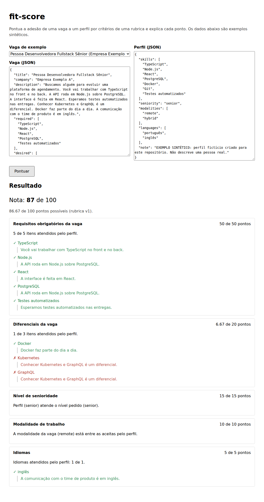
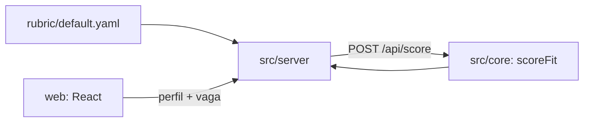

# fit-score

[](https://github.com/matheusgb/fit-score/actions/workflows/ci.yml)
[](LICENSE)

Pontua a adesão de uma vaga a um perfil profissional por **critérios explícitos de uma rubrica YAML** e mostra, para cada critério, por que a vaga recebeu aquela nota. Sem modelo de linguagem: a mesma entrada dá sempre a mesma saída.

> **Todos os dados deste repositório são sintéticos** (pasta `fixtures/`, empresas "Exemplo A/B/C"). Nada aqui vem de vagas ou pessoas reais.



## O problema

Comparar vagas com o próprio perfil costuma ser feito "no olho", e a decisão fica difícil de justificar: por que esta vaga parece melhor que aquela? O fit-score torna o critério explícito. Você escreve os pesos numa rubrica, e cada nota vem com a conta aberta: quais requisitos foram atendidos, qual trecho da descrição cita cada item e quantos pontos cada critério rendeu.

## Como rodar

Requisitos: Node.js 22 ou superior (CI e verificação local com Node 24).

```bash
npm ci
npm run build
npm start            # http://127.0.0.1:3000
```

Desenvolvimento (API e interface com recarga):

```bash
npm run dev:api      # API em :3000
npm run dev:web      # Vite, com proxy de /api para :3000
```

Verificações:

```bash
npm run typecheck    # TypeScript estrito, núcleo/servidor e interface
npm test             # testes unitários e da API (Vitest)
npm run build && npx playwright install chromium && npm run test:e2e   # ponta a ponta (Playwright)
```

Docker:

```bash
docker build -t fit-score .
docker run --rm -p 3000:3000 fit-score
```

Variáveis: `PORT` (padrão 3000), `HOST` (padrão 127.0.0.1; a imagem Docker usa 0.0.0.0), `RUBRIC_PATH` (outra rubrica).

## Como a nota é calculada

A rubrica (`rubric/default.yaml`) lista critérios com peso:

| Critério | Peso | Regra |
| --- | --- | --- |
| `required-skills` | 50 | fração dos requisitos obrigatórios que o perfil tem |
| `desired-skills` | 20 | fração dos diferenciais que o perfil tem |
| `seniority` | 15 | perfil ≥ nível pedido: total; um nível abaixo: `partialBelowOne` (0,5); menos que isso: 0 |
| `modality` | 10 | a modalidade da vaga está entre as aceitas pelo perfil |
| `languages` | 5 | fração dos idiomas pedidos que o perfil tem |

```
nota = round( pontos obtidos / pontos possíveis dos critérios aplicáveis × 100 )
```

Um critério cujo grupo está vazio na vaga (por exemplo, a vaga não lista idiomas) fica **fora do denominador** em vez de valer zero. A resposta marca `applicable: false` e diz o motivo.

Equivalências (`ts` = `TypeScript`, `k8s` = `Kubernetes`) também vêm da rubrica (`aliases`), não do código.

Resultado com os exemplos sintéticos e o perfil de exemplo (verificado em `tests/score.test.ts`):

| Vaga de exemplo | Nota | Motivo principal |
| --- | --- | --- |
| Fullstack Sênior (A) | 87 | requisitos completos; 1 de 3 diferenciais |
| Backend em Go (B) | 67 | faltam Go e Kafka entre os requisitos |
| Front-end Staff presencial (C) | 34 | nível um abaixo, modalidade não aceita; idiomas fora da nota |

## Arquitetura



- `src/core`: esquemas (zod), normalização de texto e `scoreFit`, uma função pura sem I/O.
- `src/server`: Fastify. `GET /api/health`, `/api/rubric`, `/api/examples` e `POST /api/score`, validado com os mesmos esquemas; entrada inválida volta 400 com o caminho de cada campo.
- `web`: interface React que consome a API e exibe a explicação por critério.

## Decisões e trade-offs

- **Sem LLM.** A nota precisa ser reproduzível e auditável. O custo: não entende sinônimos que a rubrica não declara.
- **Rubrica em YAML, validada na carga.** Pesos e equivalências mudam sem tocar no código; uma rubrica inválida derruba o servidor na partida em vez de pontuar errado.
- **Critério sem dados sai do denominador.** Evita punir o perfil por informação que a vaga não deu. O custo: duas notas só são comparáveis se os critérios aplicáveis forem parecidos (a resposta traz `maxPoints` para isso ficar visível).
- **Esquemas zod compartilhados** entre API e tipos da interface: um só lugar define o formato.
- **Um único pacote** (núcleo, servidor e interface) para manter o projeto simples de rodar; o servidor serve a interface compilada.

## Limites

- A busca de evidência é por palavra inteira, sem semântica. Exemplo conhecido: "Go" pode casar com o verbo em inglês "go" no texto da vaga (afeta só o trecho citado como evidência; o atendimento do requisito vem das listas estruturadas).
- Os campos estruturados da vaga (requisitos, diferenciais, nível, modalidade, idiomas) são preenchidos por quem usa; não há extração automática nem coleta de vagas.
- A nota **não prevê** contratação nem qualidade da vaga: mede só a aderência aos critérios da rubrica.
- Os pesos do exemplo são ilustrativos, não calibrados com dados.
- Sem autenticação, sem persistência e sem histórico: é uma ferramenta local.
- Testado apenas com Node 24 e Chromium (Playwright).

## Licença

[MIT](LICENSE)
